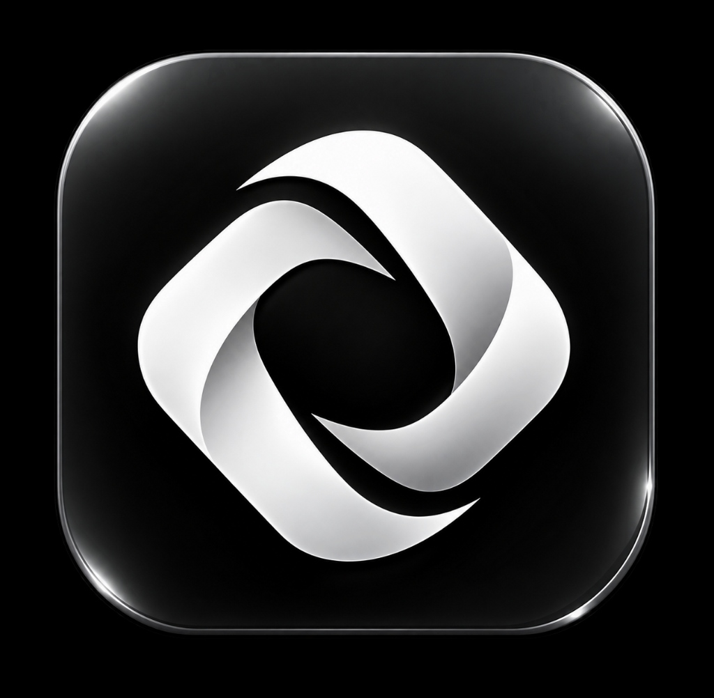
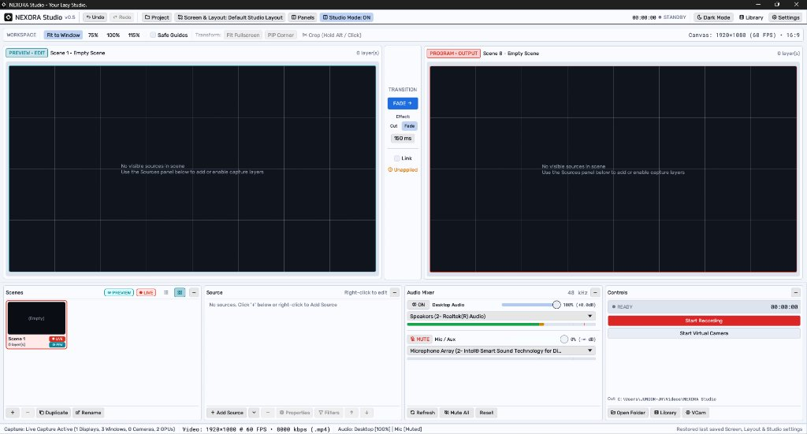

<div align="center">

  

  # NEXORA Studio

  **Your Easy, Modern & Lightweight Studio Presentation & Screen Recording Suite for Windows**

  [](https://www.rust-lang.org)
  [](https://microsoft.com/windows)
  [](https://github.com/nexora-ctrl/nexora-studio/releases)
  [](#license)

  <br />

  

</div>

---

## 📖 Tentang NEXORA Studio

**NEXORA Studio** adalah aplikasi desktop *screen recording*, siaran langsung *virtual camera*, dan *presentation studio* native Windows berkinerja tinggi yang dibangun 100% menggunakan bahasa pemrograman **Rust** dan framework UI GUI **`egui` / `eframe`**.

Didesain secara khusus agar sangat ringan, responsif, dan bebas beban berat (*zero bloat*), NEXORA Studio menghadirkan antarmuka studio profesional ala OBS Studio namun jauh lebih ringkas, mudah digunakan oleh presenter, pengajar, streamer, dan profesional tanpa konfigurasi yang rumit.

---

## ✨ Fitur Utama (Key Features)

### 🎛️ Dual-Canvas Studio Mode (Preview & Program)
- **16:9 Aspect Ratio Viewport:** Tampilan kanvas presisi 1920×1080 (60 FPS) dengan rasio standar industri siaran.
- **Transisi Halus (Smooth Transitions):** Jembatan transisi instan (**Cut**) maupun transisi mulus (**Fade**) dengan durasi milidetik yang dapat diatur.
- **Isolasi Penuh State Preview vs Program:** Edit, geser, rotasi, ubah layer dan filter di *Preview* secara bebas tanpa mengganggu tampilan *Program (LIVE)* sebelum Anda menekan tombol **Transition**.

### 🎥 Native Windows Virtual Camera (DirectShow Driver)
- **Kompatibilitas Luas:** Langsung terdeteksi secara otomatis di **Zoom, Microsoft Teams, Google Meet, Discord, Skype, OBS Studio**, dan browser WebRTC tanpa perlu restart PC.
- **Zero-Admin Driver Installation:** Mendaftarkan driver kamera DirectShow native (`CLSID_VideoInputDeviceCategory`) di tingkat pengguna (tanpa memerlukan hak Administrator Windows).
- **High-Speed Shared Memory Ring Buffer:** Menggunakan protokol shared memory IPC `OBSVirtualCamVideo` berformat NV12 1080p @ 30 FPS untuk latensi ultra rendah dan zero-lag.
- **Output Pilihan:** Pilih sumber output Virtual Camera dari *Program (LIVE)*, *Preview*, atau *Scene* tertentu.

### 🧩 Beragam Sumber Input (Rich Layer Sources)
- **Display & Window Capture:** Rekam seluruh layar monitor atau jendela aplikasi Windows tertentu dengan performa tinggi.
- **Webcam / Video Capture Device:**
  - Sudut membulat (*Rounded Corner Radius*) dari `0px` hingga `160px` (lengkap dengan preset *Square*, *Smooth*, *Medium*, hingga *Circle / Avatar*).
  - Garis tepi (*Outline / Border*) kustom dengan ketebalan dan palet warna siaran instan.
- **PowerPoint (PPT) Source:** Integrasi langsung COM automation untuk slide presentasi HD dengan kontrol navigasi slide pointer / remote.
- **Clock & Timer (`TimeSource`):**
  - Mode: Jam Real-Time Windows, Stopwatch (Hitung Maju), dan Countdown (Hitung Mundur).
  - 4 Efek Visual Modern: *Digital LED Neon Glow*, *TV Corner Badge*, *Minimalist Clean*, dan *Dark Glass Card*.
  - Opsi format 12/24 jam, badge label dinamis, dan penyesuaian font lengkap.
- **Media Video & Audio:** Pemutaran file video/audio lokal dengan sinkronisasi playback otomatis saat live.
- **Gambar & Slide Show:** Dukungan gambar tunggal maupun slideshow transisi otomatis.
- **Color & Text Source:** Layer warna latar dan tipografi teks overlay.

### 🎨 Filter & Manipulasi Visual Tingkat Lanjut
- **Chroma Key & Color Key:** Hapus background hijau/biru dengan kontrol *similarity*, *smoothness*, dan *spill reduction*.
- **Screen Color Picker (Pipet Layar):** Ambil sampel warna RGB langsung dari area layar manapun menggunakan Win32 `GetPixel` real-time dengan floating magnifier.
- **OBS-Style Transform Menu:**
  - Rotasi: `90° CW`, `90° CCW`, `180°`.
  - Flip: `Horizontal`, `Vertical`.
  - Snap: `Fit to Screen (Ctrl+F)`, `Stretch (Ctrl+S)`, `Center (Ctrl+D)`, `Reset (Ctrl+R)`.
  - Preset Picture-in-Picture (PiP): *Bottom-Right*, *Bottom-Left*, *Top-Right*.
- **Crop Presisi:** Potong tepi layer secara instan dengan menahan `Alt + Drag` di kanvas atau via slider angka.

### 🔊 Audio Mixer Terintegrasi
- **WASAPI Desktop Audio & Microphones:** Rekam suara sistem dan input mikrofon secara simultan.
- **Peak Level Meter Real-Time:** Indikator volume desibel (dB) responsif dengan peringatan kliping (*peaking indicator*).
- **Kontrol Mute & Volume:** Slider gain volume presisi serta tombol mute instan.

### 🗂️ Manajemen Scene & Layer
- **Tampilan Fleksibel:** Pilihan tampilan *List View* ringkas atau *Grid View* lengkap dengan thumbnail 16:9 real-time isi scene.
- **Copy & Paste Antar Scene:** Salin layer beserta seluruh konfigurasi dan filternya via `Ctrl+C` lalu tempelkan di scene lain via `Ctrl+V`.
- **Z-Order Standar OBS:** Layer baris atas otomatis berada di depan (foreground) dan baris bawah sebagai latar (background).

### 🖥️ Fullscreen Projector Layar Kedua
- Klik kanan kanvas -> buka projector ke monitor sekunder secara otomatis untuk kebutuhan seminar, proyektor ruang rapat, atau panggung.
- Keluar projector instan cukup dengan menekan tombol `Esc`.

### 🔄 In-App Auto Updater
- Pemindaian otomatis rilis terbaru dari repositori GitHub saat aplikasi dibuka.
- Indikator badge hijau halus di Top Bar (`Pembaruan tersedia: Update Sekarang`).
- Pembersihan otomatis file binary lama (`.old`) setelah pembaruan selesai.

---

## ⌨️ Tombol Pintas (Keyboard Shortcuts)

| Pintasan Keyboard | Aksi |
| :--- | :--- |
| **`Ctrl + F`** | Fit layer terpilih ke ukuran layar kanvas (*Fit to Screen*) |
| **`Ctrl + S`** | Rentangkan layer memenuhi layar (*Stretch to Screen*) |
| **`Ctrl + D`** | Letakkan layer tepat di tengah kanvas (*Center to Screen*) |
| **`Ctrl + R`** | Reset ukuran dan posisi layer ke default (*Reset Transform*) |
| **`Ctrl + C`** | Salin konfigurasi layer terpilih (*Copy Source*) |
| **`Ctrl + V`** | Tempelkan layer yang disalin ke scene saat ini (*Paste Source*) |
| **`Alt + Drag Edge`** | Crop tepi layer secara langsung di area Preview kanvas |
| **`Esc`** | Tutup Fullscreen Projector / Batalkan Color Picker |

---

## 🚀 Instalasi & Menjalankan

### Cara 1: Menggunakan Binary Siap Pakai (Rekomendasi)
1. Unduh rilis executable terbaru (`nexora-studio.exe`) dari tab [**GitHub Releases**](https://github.com/nexora-ctrl/nexora-studio/releases).
2. Simpan di folder mana saja di komputer Anda (misalnya `C:\Program Files\NEXORA Studio` atau Desktop).
3. Jalankan `nexora-studio.exe` langsung (Portabel, tanpa installer berat).

### Cara 2: Build Mandiri dari Source Code

Pastikan Anda telah menginstal **Rust** (toolchain Windows `stable-x86_64-pc-windows-gnu` atau `msvc`).

```powershell
# 1. Clone repositori
git clone https://github.com/nexora-ctrl/nexora-studio.git
cd nexora-studio

# 2. Jalankan test otomatis
cargo test

# 3. Jalankan aplikasi dalam mode Debug
cargo run

# 4. Atau kompilasi file biner Release yang dioptimasi
cargo build --release
```

Hasil file executable akan berada di folder `target/release/nexora-studio.exe` (atau sesuai konfigurasi `target-dir` Anda).

---

## 🛠️ Arsitektur & Teknologi (Tech Stack)

- **Language:** [Rust](https://www.rust-lang.org/) (Edisi 2021)
- **GUI Framework:** [egui](https://github.com/emilk/egui) & [eframe](https://github.com/emilk/egui/tree/master/crates/eframe) `0.31` (Hardware-accelerated via Glow/WGPU)
- **Typography & Icons:**
  - Font Brand: **Exo** (Offline OFL)
  - UI Font: **Rubik** (Offline OFL, Light & Regular)
  - Monospace Font: **Roboto Mono** (Offline OFL)
  - Icons: **Tabler Icons** (5.900+ icon embedded offline)
- **Windows Native APIs:** `windows-rs` & `windows-sys` (Media Foundation, WASAPI Loopback, DirectShow IPC, Win32 Registry, COM Automation).
- **Virtual Camera IPC:** Shared Memory `OBSVirtualCamVideo` (NV12 triple-buffered 1080p @ 30 FPS).

---

## 📄 Lisensi (License)

NEXORA Studio dilisensikan di bawah lisensi ganda [MIT](LICENSE-MIT) atau [Apache-2.0](LICENSE-APACHE).

---

<div align="center">
  <sub>Dibuat dengan ❤️ dan dedikasi oleh tim NEXORA Studio untuk komunitas kreator dan presenter Indonesia & dunia.</sub>
</div>
